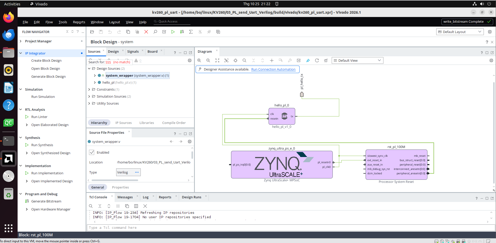

# KV260 – UART viết bằng Verilog trong PL

Khối Verilog tự viết (`hw/hello_pl.v`) nằm trong **PL (FPGA)** của Kria KV260, **tự gửi** chuỗi `Hello World from PL (Verilog)` mỗi giây ra **PMOD J2 chân 1**. Chân này nối vào **RXD của module CH340**, CH340 cắm vào máy tính và hiện ra ở `/dev/serial/by-id/usb-1a86_USB_Serial-if00-port0` (thường là `ttyUSB4`, có lúc là `ttyUSB0`).

**Không có code C, không có CPU chạy.** PS chỉ cấp clock 100 MHz và tín hiệu reset cho PL. Toàn bộ phần UART (chia baud, start/data/stop bit, gửi chuỗi) đều là phần cứng do Verilog mô tả.

Đã chạy thành công trên board ngày **25/10/2026**. Kết quả thật trên cổng của CH340 (115200 8N1):

```
Terminal ready
Hello World from PL (Verilog)
Hello World from PL (Verilog)
Hello World from PL (Verilog)
...
```

```
       ┌──────────────── Zynq UltraScale+ (xck26) ────────────────┐
       │  PS                     │  PL                             │
       │                         │                                 │
       │  pl_clk0 (100 MHz) ─────┼──┬──► rst_pl_100M ──┐           │
       │  pl_resetn0 ────────────┼──┼──►(proc_sys_reset)│ resetn   │
       │                         │  │                   ▼           │
       │                         │  └────────────► hello_pl ── tx ──┼──► PMOD J2 chân 1 (H12) ──► RXD CH340 ──USB──► /dev/ttyUSBx
       │                         │                 └ uart_tx        │    PMOD J2 chân 9 (GND) ──── GND CH340
       └─────────────────────────┴─────────────────────────────────┘
```

---

## Mục lục

1. [Nối dây CH340 vào PMOD J2](#1-nối-dây-ch340-vào-pmod-j2)
2. [Cấu trúc thư mục](#2-cấu-trúc-thư-mục)
3. [Tạo bitstream bằng Vivado](#3-tạo-bitstream-bằng-vivado)
4. [Nạp bitstream bằng xsdb](#4-nạp-bitstream-bằng-xsdb)
5. [Đọc code Verilog](#5-đọc-code-verilog)
6. [Các lỗi có thể gặp](#6-các-lỗi-có-thể-gặp)
7. [Tóm tắt lệnh](#7-tóm-tắt-lệnh)
8. [Bước tiếp theo](#8-bước-tiếp-theo)

---

## 1. Nối dây CH340 vào PMOD J2

### 1.1 Chân PMOD J2 trên carrier KV260

Nhìn thẳng vào miệng đầu cắm J2 (2 hàng × 6 lỗ). Hàng trên là chân lẻ, hàng dưới là chân chẵn:

```
              chân 1 (có đánh dấu trên board)
                ↓
              ┌────┬────┬────┬────┬────┬────┐
  hàng trên   │ 1  │ 3  │ 5  │ 7  │ 9  │ 11 │
              ├────┼────┼────┼────┼────┼────┤
  hàng dưới   │ 2  │ 4  │ 6  │ 8  │ 10 │ 12 │
              └────┴────┴────┴────┴────┴────┘
               TX                  GND  3.3V
                                   GND  3.3V
```

| Chân PMOD J2 | FPGA pin | Dùng trong project |
|---|---|---|
| **1** | **H12** | `pl_hello_tx`: TX của khối `hello_pl` |
| 3, 5, 7, 2, 4, 6, 8 | E10, D10, C11, B10, E12, D11, B11 | Trống |
| **9, 10** | – | **GND** |
| 11, 12 | – | 3.3V (không dùng) |

Tất cả chân tín hiệu là mức **3.3V** (LVCMOS33). Gán chân nằm trong `hw/pins.xdc`. Chân 1 = H12 và GND = chân 9 đã được kiểm chứng bằng lần chạy thật trên board.

### 1.2 Cách nối

Cần 2 sợi dây dupont **đực–cái**: đầu đực cắm vào lỗ J2, đầu cái cắm vào chân của module CH340. **Tắt nguồn board trước khi cắm.**

| CH340 | PMOD J2 | Ghi chú |
|---|---|---|
| **RXD** | **chân 1** | TX của board nối RX của CH340 (bắt chéo) |
| **GND** | **chân 9** | Bắt buộc phải chung GND |
| TXD | không nối | Project này chỉ gửi ra, không nhận |
| VCC / 5V / 3V3 | **không nối** | CH340 lấy nguồn từ USB máy tính |

```
   KV260 J2                         CH340
   chân 1  (TX PL) ──────────────►  RXD
   chân 9  (GND)   ──────────────── GND
                                    TXD   (để trống)
                                    VCC   (để trống, KHÔNG nối)
                                    USB ──► máy tính
```

### 1.3 Gắn CH340 vào máy ảo

Cắm USB của CH340 vào máy tính. Trong VMware: **VM → Removable Devices → QinHeng Electronics (CH340) → Connect**. Kiểm tra:

```bash
lsusb | grep 1a86
ls -l /dev/serial/by-id/
```

Kết quả thật:

```
Bus 001 Device 004: ID 1a86:7523 QinHeng Electronics CH340 serial converter

usb-1a86_USB_Serial-if00-port0 -> ../../ttyUSB4                          <- CH340
usb-Xilinx_ML_Carrier_Card_XFL1JHTHX0HQ-if00-port0 -> ../../ttyUSB0       <- FTDI trên board
usb-Xilinx_ML_Carrier_Card_XFL1JHTHX0HQ-if01-port0 -> ../../ttyUSB1
usb-Xilinx_ML_Carrier_Card_XFL1JHTHX0HQ-if02-port0 -> ../../ttyUSB2
usb-Xilinx_ML_Carrier_Card_XFL1JHTHX0HQ-if03-port0 -> ../../ttyUSB3
```

FTDI của board (cáp micro-USB J4) tạo ra `ttyUSB0..3`, nên lúc này CH340 là `ttyUSB4`.

**Tên `ttyUSBx` của CH340 có thể thay đổi.** Khi xsdb `connect`, `hw_server` chiếm kênh 0 của FTDI làm JTAG nên `ttyUSB0` biến mất. Nếu cắm (hoặc gắn lại vào VM) CH340 lúc đó, nó sẽ thành **`ttyUSB0`**. Vì vậy luôn mở CH340 bằng **tên cố định** trong `/dev/serial/by-id/` (đặt theo chip `1a86` = CH340, không phụ thuộc thứ tự cắm):

```
/dev/serial/by-id/usb-1a86_USB_Serial-if00-port0
```

Xem CH340 đang là `ttyUSB` số mấy: `ls -l /dev/serial/by-id/ | grep 1a86`.

---

## 2. Cấu trúc thư mục

### 2.1 Trước khi build

```
03_PL_send_Uart_Verilog/
├── Makefile                  make hw / make console / make clean
├── README.md                 Tài liệu này
├── images/                   Ảnh chụp màn hình dùng trong README
└── hw/
    ├── create_hw.tcl         Script Vivado: Zynq (clock/reset) + hello_pl -> bitstream -> XSA
    ├── hello_pl.v            Verilog: uart_tx + khối tự gửi "Hello World"
    └── pins.xdc              Gán chân: pl_hello_tx -> H12 (PMOD J2 chân 1), LVCMOS33
```

| File | Dùng ở bước |
|---|---|
| `hw/hello_pl.v` | Vivado (mục 3) |
| `hw/pins.xdc` | Vivado (mục 3) |
| `hw/create_hw.tcl` | `make hw` hoặc Vivado GUI (mục 3, cách A và B) |

### Xóa kết quả build để làm lại từ đầu

Chỉ có thư mục `build/` (và `.Xil/` nếu có) là sinh ra khi build. Các file khác là file nguồn, giữ nguyên. Nếu đang mở project trong Vivado GUI, **đóng Vivado trước khi xóa**.

```bash
cd ~/linux/KV260/03_PL_send_Uart_Verilog
make clean
```

hoặc gõ trực tiếp:

```bash
cd ~/linux/KV260/03_PL_send_Uart_Verilog
rm -rf build .Xil
```

Lệnh này xóa `build/kv260_pl_uart.xsa`, `build/hw/` (bitstream `.bit`, `psu_init.tcl`) và `build/vivado/` (project Vivado). Kiểm tra:

```bash
ls -A
```

```
hw  images  Makefile  README.md
```

Sau đó làm lại từ mục 3.

### 2.2 Sau khi build

```
03_PL_send_Uart_Verilog/
├── (các file ở 2.1)
└── build/                                  ◄ make hw hoặc Vivado GUI (mục 3)
    ├── kv260_pl_uart.xsa                   XSA: thiết kế + bitstream + psu_init
    ├── hw/
    │   ├── psu_init.tcl                    ★ Khởi tạo PS (clock pl_clk0, reset), dùng trong xsdb
    │   └── kv260_pl_uart.bit               ★ BITSTREAM, nạp vào PL bằng xsdb
    └── vivado/
        ├── kv260_pl_uart.xpr               Project Vivado
        └── kv260_pl_uart.runs/impl_1/      Báo cáo timing, tài nguyên, chân I/O
```

---

## 3. Tạo bitstream bằng Vivado

### 3.1 Thiết kế gồm những gì

Block design `system` có 3 khối:

| Khối | Loại | Vai trò |
|---|---|---|
| `zynq_ultra_ps_e_0` | IP Zynq UltraScale+ MPSoC (preset KV260) | Cấp clock **`pl_clk0` = 100 MHz** và reset **`pl_resetn0`** cho PL. Tắt hết cổng AXI |
| `rst_pl_100M` | IP Processor System Reset | Đồng bộ `pl_resetn0` với clock `pl_clk0`, tạo `peripheral_aresetn` (mức thấp) |
| `hello_pl_0` | Module tự viết (`hello_pl.v`), thêm dạng *module reference* | Tạo tín hiệu UART TX, ra port `pl_hello_tx` |

Port `pl_hello_tx` được `pins.xdc` gán vào chân **H12** (PMOD J2 chân 1).

PL phải lấy clock từ PS vì trên KV260 không có bộ dao động riêng nối trực tiếp vào PL. Vì vậy dù không chạy code, **vẫn phải chạy `psu_init`** để bật `pl_clk0` (mục 4).

### 3.2 Chọn cách tạo

Có 3 cách, kết quả giống nhau: `build/kv260_pl_uart.xsa`, `build/hw/kv260_pl_uart.bit`, `build/hw/psu_init.tcl`. Mỗi cách mất khoảng **3–5 phút** (synthesis + implementation + bitstream).

| Cách | Dùng gì | Khi nào nên dùng |
|---|---|---|
| A | Terminal: `make hw` | Mặc định, nhanh, lần nào cũng ra kết quả giống nhau |
| B | Vivado GUI chạy script `create_hw.tcl` | Muốn nhìn Vivado tạo từng bước trên màn hình |
| C | Vivado GUI, tự bấm tay từng bước | Muốn hiểu script làm gì (nên làm một lần để học) |

Mọi terminal đều phải nạp môi trường trước:

```bash
cd ~/linux/KV260/03_PL_send_Uart_Verilog
source /home/bo/AMD/2026.1/Vitis/settings64.sh
```

### 3.3 Cách A: Terminal (`make hw`)

```bash
make hw
```

Lệnh này chạy `vivado -mode batch -source hw/create_hw.tcl` (không mở cửa sổ), rồi lấy `psu_init.tcl` và file `.bit` ra khỏi XSA. Các dòng cuối:

```
INFO: [Vivado 12-1842] Bitgen Completed Successfully.
INFO: Da tao /home/bo/linux/KV260/03_PL_send_Uart_Verilog/build/kv260_pl_uart.xsa
unzip -o build/kv260_pl_uart.xsa psu_init.tcl '*.bit' -d build/hw
  inflating: build/hw/psu_init.tcl
  inflating: build/hw/kv260_pl_uart.bit
```

Kết quả build thật:

| Mục | Giá trị |
|---|---|
| Timing | **WNS = +7.854 ns** ở 100 MHz (dương = đạt timing) |
| Tài nguyên | **99 LUT, 102 FF** (khoảng 0.1% chip) |
| Chân | `pl_hello_tx` → **H12**, LVCMOS33 |

`make hw` chỉ chạy lại khi `create_hw.tcl`, `hello_pl.v` hoặc `pins.xdc` thay đổi. Nếu báo `make: Nothing to be done for 'hw'.` thì bitstream đã mới nhất. Muốn ép chạy lại: `make -B hw`.

### 3.4 Cách B: Chạy script trong Vivado GUI

```bash
cd ~/linux/KV260/03_PL_send_Uart_Verilog
source /home/bo/AMD/2026.1/Vitis/settings64.sh
mkdir -p build && cd build      # để vivado.log, vivado.jou nằm trong build/
vivado &
```

Menu **Tools → Run Tcl Script…** → ô **File name** gõ đường dẫn đầy đủ `/home/bo/linux/KV260/03_PL_send_Uart_Verilog/hw/create_hw.tcl` → **Open**. Hoặc gõ vào ô **Tcl Console**: `source ../hw/create_hw.tcl`.

Chờ đến khi Tcl Console hiện `INFO: Da tao .../build/kv260_pl_uart.xsa`. Sau đó lấy `psu_init.tcl` và bitstream ra (terminal):

```bash
cd ~/linux/KV260/03_PL_send_Uart_Verilog
unzip -o build/kv260_pl_uart.xsa psu_init.tcl '*.bit' -d build/hw
```

### 3.5 Cách C: Tự bấm tay trong Vivado GUI

Mở Vivado như cách B, rồi làm lần lượt. **Mọi ô đường dẫn đều gõ đường dẫn đầy đủ, bắt đầu bằng `/`.** Nếu gõ đường dẫn tương đối, Vivado sẽ tính từ thư mục project và ghi file sai chỗ.

**Bước 1: Tạo project.** Menu **File → Project → New** → Next:

| Màn hình | Chọn |
|---|---|
| Project Name | Name: `kv260_pl_uart`, Location: `/home/bo/linux/KV260/03_PL_send_Uart_Verilog/build/vivado`, **bỏ tích** *Create project subdirectory* |
| Project Type | **RTL Project** (không tích *Do not specify sources*) |
| Add Sources | **Add Files** → `/home/bo/linux/KV260/03_PL_send_Uart_Verilog/hw/hello_pl.v`. Bỏ tích *Copy sources into project* |
| Add Constraints | **Add Files** → `/home/bo/linux/KV260/03_PL_send_Uart_Verilog/hw/pins.xdc`. Bỏ tích *Copy constraints files into project* |
| Default Part | Tab **Boards** → **Kria KV260 Vision AI Starter Kit SOM** → bấm *Connections* → carrier **KV260** → Next → Finish |

Nếu tab Boards không có KV260: bấm **Refresh** (hoặc *Download* ở cột Status).

**Bước 2: Tạo block design.** Flow Navigator → **IP INTEGRATOR → Create Block Design** → Design name: `system` → OK.

**Bước 3: Thêm Zynq.** Trong Diagram bấm **+** → gõ `zynq` → **Zynq UltraScale+ MPSoC**. Thanh xanh → **Run Block Automation** → tích **Apply Board Preset** → OK.

**Bước 4: Chỉnh Zynq.** Double-click khối Zynq:
- **PS-PL Configuration → PS-PL Interfaces → Master Interface**: bỏ tích **AXI HPM0 FPD**, **AXI HPM1 FPD**, **AXI HPM0 LPD** (PL không nói chuyện với CPU).
- **Clock Configuration → Output Clocks → Low Power Domain Clocks → PL Fabric Clocks**: tích **PL0**, đặt **100 MHz**.
- Kiểm tra **PS-PL Configuration → General → Fabric Reset Enable**: đã tích, *Number of Fabric Resets* = 1 (tạo chân `pl_resetn0`).
- OK. Khối Zynq giờ có chân `pl_clk0` và `pl_resetn0`.

**Bước 5: Thêm Processor System Reset.** **+** → gõ `reset` → **Processor System Reset**. Đổi tên (ô *Name* trong *Block Properties*) thành `rst_pl_100M`. Nối:
- `zynq_ultra_ps_e_0/pl_clk0` → `rst_pl_100M/slowest_sync_clk`
- `zynq_ultra_ps_e_0/pl_resetn0` → `rst_pl_100M/ext_reset_in`

**Bước 6: Thêm hello_pl.** Chuột phải vùng trống Diagram → **Add Module…** → chọn **hello_pl** → OK. Nối:
- `zynq_ultra_ps_e_0/pl_clk0` → `hello_pl_0/clk`
- `rst_pl_100M/peripheral_aresetn` → `hello_pl_0/resetn`

**Bước 7: Tạo chân ra ngoài.** Chuột phải chân `hello_pl_0/tx` → **Make External**. Chọn port vừa tạo, trong *External Port Properties* đổi *Name* thành **`pl_hello_tx`** (phải **trùng tên trong `pins.xdc`**, nếu không bước 10 sẽ báo lỗi chân).

**Bước 8: Kiểm tra.** **Validate Design** (F6). Phải báo *Validation successful*. Nếu có cảnh báo chân `pl_ps_irq0` hay `maxihpm0_*_aclk` chưa nối: xem lại bước 4 (phải tắt hết cổng AXI).

**Bước 9: Sinh output và wrapper.** Tab Sources → chuột phải `system.bd`:
- **Generate Output Products** → Generate.
- **Create HDL Wrapper** → *Let Vivado manage wrapper and auto-update* → OK.
- **Đặt wrapper làm top (bắt buộc):** trong nhóm **Design Sources**, chuột phải **`system_wrapper`** → **Set as Top**. `system_wrapper` phải được in đậm. Vì ở bước 1 đã thêm `hello_pl.v` trước, Vivado tự chọn `hello_pl` làm top và **không tự đổi** sang wrapper. Nếu bỏ qua, Vivado chỉ tổng hợp riêng `hello_pl` (xem [lỗi "No ports matched"](#6-các-lỗi-có-thể-gặp)).

**Bước 10: Tạo bitstream.** Flow Navigator → **PROGRAM AND DEBUG → Generate Bitstream** → Yes (Vivado tự chạy Synthesis và Implementation trước). Chờ 3–5 phút đến khi hiện *Bitstream Generation Completed*.

Kiểm tra top đúng: tab **Log** (hoặc file `build/vivado/kv260_pl_uart.runs/synth_1/runme.log`) phải có dòng `synth_design -top system_wrapper`, **không phải** `-top hello_pl`.

Kết quả sau bước 10 (làm tay):



Cách đọc màn hình:
- Góc trên bên phải: **write_bitstream Complete** có dấu tích xanh, nghĩa là đã tạo xong bitstream.
- **Sources → Design Sources**: **`system_wrapper`** in đậm, có biểu tượng top bên cạnh. `hello_pl` nằm riêng bên dưới, không phải top.
- **Diagram**: đủ 3 khối và các dây nối:
  - `zynq_ultra_ps_e_0/pl_clk0` → `hello_pl_0/clk` và `rst_pl_100M/slowest_sync_clk`
  - `zynq_ultra_ps_e_0/pl_resetn0` → `rst_pl_100M/ext_reset_in`
  - `rst_pl_100M/peripheral_aresetn` → `hello_pl_0/resetn`
  - `hello_pl_0/tx` → port ra ngoài **`pl_hello_tx`** (mũi tên ở phía trên sơ đồ, tên port phải trùng với `pins.xdc`)
- Chân `pl_ps_irq0` của Zynq và các chân `mb_reset`, `bus_struct_reset`, `interconnect_aresetn`... của `rst_pl_100M` để trống là đúng, vì không dùng.
- Dòng **Run Connection Automation**: bỏ qua, không cần bấm.

**Bước 11: Xuất XSA.** Menu **File → Export → Export Hardware**:
- Output: **Include bitstream**.
- XSA file name: `kv260_pl_uart`
- Export to: **`/home/bo/linux/KV260/03_PL_send_Uart_Verilog/build`** (đường dẫn đầy đủ). Nếu chỉ gõ `build`, file sẽ bị ghi vào `build/vivado/build/kv260_pl_uart.xsa`.
- Finish.

**Bước 12: Lấy `psu_init.tcl` và bitstream** (terminal):

```bash
cd ~/linux/KV260/03_PL_send_Uart_Verilog
unzip -o build/kv260_pl_uart.xsa psu_init.tcl '*.bit' -d build/hw
```

**Bước 13: Kiểm tra** (terminal). Phải có đủ 3 file đúng chỗ:

```bash
ls -l build/kv260_pl_uart.xsa build/hw/psu_init.tcl build/hw/kv260_pl_uart.bit
```

Nếu báo `No such file or directory` ở dòng nào thì xem lại bước 11 (cho `.xsa`) hoặc bước 12 (cho 2 file kia). Lỡ xuất XSA sai chỗ thì chuyển về bằng `mv build/vivado/build/kv260_pl_uart.xsa build/`.

Mỗi bước tay ứng với một đoạn trong `hw/create_hw.tcl`:

| Bước tay | Lệnh Tcl trong script |
|---|---|
| 1. Project + nguồn | `create_project ... -part xck26-sfvc784-2LV-c`, `set_property board_part`, `add_files hello_pl.v`, `add_files -fileset constrs_1 pins.xdc` |
| 2. Block design | `create_bd_design "system"` |
| 3. Zynq + preset | `create_bd_cell ... zynq_ultra_ps_e`, `apply_bd_automation ... {apply_board_preset "1"}` |
| 4. Chỉnh Zynq | `CONFIG.PSU__USE__M_AXI_GP0/1/2 {0}`, `CONFIG.PSU__FPGA_PL0_ENABLE {1}`, `CONFIG.PSU__CRL_APB__PL0_REF_CTRL__FREQMHZ {100}` |
| 5. Reset | `create_bd_cell ... proc_sys_reset rst_pl_100M`, `connect_bd_net` |
| 6. hello_pl | `create_bd_cell -type module -reference hello_pl`, `connect_bd_net` |
| 7. Chân ra | `create_bd_port -dir O pl_hello_tx`, `connect_bd_net` |
| 8. Validate | `validate_bd_design` |
| 9. Output + wrapper + top | `generate_target all`, `make_wrapper -top`, `set_property top system_wrapper [current_fileset]` |
| 10. Bitstream | `launch_runs impl_1 -to_step write_bitstream`, `wait_on_run impl_1` |
| 11. Export | `write_hw_platform -fixed -include_bit -file build/kv260_pl_uart.xsa` |
| 12. Lấy file | `unzip` trong `Makefile` |

Tên menu viết theo các bản Vivado gần đây, bản 2026.1 có thể khác một chút. Sau cách C, nếu chạy `make -B hw` thì script sẽ **ghi đè** project bấm tay.

### 3.6 Xem kết quả trong Vivado

```bash
cd ~/linux/KV260/03_PL_send_Uart_Verilog
vivado build/vivado/kv260_pl_uart.xpr &
```

- **Open Block Design**: sơ đồ 3 khối Zynq, `rst_pl_100M`, `hello_pl_0`.
- **Open Implemented Design**:
  - **Report Timing Summary**: WNS dương là đạt.
  - **Report Utilization**: số LUT/FF đã dùng.
  - Menu **Window → I/O Ports**: `pl_hello_tx` ở chân H12, LVCMOS33.
  - **Window → Device**: xem các ô logic của `hello_pl` nằm ở đâu trên chip.

---

## 4. Nạp bitstream bằng xsdb

Cần 2 terminal.

### 4.1 Terminal 1: mở cổng CH340

```bash
picocom -b 115200 /dev/serial/by-id/usb-1a86_USB_Serial-if00-port0    # = make console
```

```
port is        : /dev/serial/by-id/usb-1a86_USB_Serial-if00-port0
flowcontrol    : none
baudrate is    : 115200
...
Terminal ready
```

Để nguyên terminal này. Thoát picocom: `Ctrl+A` rồi `Ctrl+X`.

### 4.2 Terminal 2: xsdb

```bash
cd ~/linux/KV260/03_PL_send_Uart_Verilog
source /home/bo/AMD/2026.1/Vitis/settings64.sh
xsdb
```

**Bước 1: Kết nối, chuyển sang boot JTAG, reset hệ thống**

```tcl
connect
targets -set -filter {name =~ "PSU"}
mwr 0xff5e0200 0x0100
rst -system
after 2000
```

| Lệnh | Ý nghĩa |
|---|---|
| `connect` | Khởi động `hw_server`, kết nối JTAG qua FTDI (cáp micro-USB J4) |
| `mwr 0xff5e0200 0x0100` | `CRL_APB.BOOT_MODE_USER` = JTAG. KV260 không có công tắc boot mode |
| `rst -system` | Reset toàn bộ chip. Sau reset chip không boot Linux từ QSPI nữa |

**Bước 2: Khởi tạo PS (bật clock cho PL)**

```tcl
targets -set -filter {name =~ "APU*"}
source build/hw/psu_init.tcl
psu_init
```

`psu_init` cấu hình PLL và các clock, trong đó có **`pl_clk0` = 100 MHz** cấp cho PL. Không có bước này thì PL không có clock, `hello_pl` không chạy.

**Bước 3: Nạp bitstream vào PL**

```tcl
fpga -file build/hw/kv260_pl_uart.bit
```

```
100%    7MB   1.6MB/s  00:04
```

Lệnh `fpga` ghi bitstream qua JTAG vào PL. Lúc này PL đã có mạch `hello_pl`, nhưng vẫn đang bị cách ly với PS và giữ reset.

**Bước 4: Bỏ cách ly PS–PL, nhả reset PL**

```tcl
psu_ps_pl_isolation_removal
psu_ps_pl_reset_config
```

| Lệnh | Ý nghĩa |
|---|---|
| `psu_ps_pl_isolation_removal` | Bỏ cách ly giữa PS và PL, cho phép tín hiệu `pl_clk0`, `pl_resetn0` đi qua |
| `psu_ps_pl_reset_config` | Điều khiển GPIO EMIO bank 5 bit 31 (`pl_resetn0`): kéo xuống 0 rồi lên 1, tức là reset PL rồi nhả ra. `rst_pl_100M` đưa reset này tới `hello_pl` |

**Ngay sau lệnh cuối**, terminal 1 hiện mỗi giây một dòng:

```
Hello World from PL (Verilog)
Hello World from PL (Verilog)
Hello World from PL (Verilog)
...
```

Không cần nạp chương trình nào cho CPU. Có thể thoát xsdb (`disconnect`, `exit`): PL vẫn tiếp tục gửi cho đến khi rút nguồn hoặc reset board.

### 4.3 Kiểm tra trạng thái khi không thấy chữ

Gõ trong xsdb:

```tcl
targets -set -filter {name =~ "PSU"}
mrd 0xffca3010      ;# CSU.PCAP_STATUS: bit 3 = 1 nghĩa là PL đã nạp xong (DONE)
mrd 0xff5e00c0      ;# CRL_APB.PL0_REF_CTRL: 01010A00 = pl_clk0 đang bật, 100 MHz
mrd 0xff0a0054      ;# GPIO.DATA_5: 80000000 = pl_resetn0 = 1 (đã nhả reset)
```

Có thể đo bằng đồng hồ vạn năng: giữa PMOD chân 1 và GND phải được khoảng **3.3V** (UART nghỉ ở mức cao). Đo được 0V nghĩa là PL chưa chạy.

### 4.4 Sửa Verilog rồi nạp lại

1. Sửa `hw/hello_pl.v` (ví dụ đổi chuỗi `MSG` và `MSG_LEN`).
2. `make hw` để tạo bitstream mới (3–5 phút).
3. Nạp lại: **làm lại toàn bộ mục 4.2** từ `connect`. Có thể chỉ chạy lại bước 3–4 nếu board chưa rút nguồn, nhưng làm lại từ đầu là chắc chắn nhất.

---

## 5. Đọc code Verilog

File `hw/hello_pl.v` có 2 module.

### 5.1 `uart_tx`: bộ phát UART 8N1

```
tx: ‾‾‾‾‾\_____/‾‾‾‾\____ ... ____/‾‾‾‾‾‾‾‾
         start  d0   d1   ...  d7  stop
         (0)    LSB trước          (1)
         |<-->| mỗi bit = CLKS_PER_BIT = 100e6 / 115200 ≈ 868 chu kỳ clock = 8.68 µs
```

| Tín hiệu | Ý nghĩa |
|---|---|
| `CLKS_PER_BIT` | Số chu kỳ clock cho 1 bit: `(CLK_HZ + BAUD/2) / BAUD` = 868 (làm tròn, sai số 0.004%) |
| `shifter` | 10 bit `{1, data[7:0], 0}`: stop bit, 8 bit data, start bit |
| `clk_cnt` | Đếm 0 → 867 trong mỗi bit |
| `bit_idx` | 0 = start, 1..8 = data, 9 = stop |
| `busy` | 1 trong lúc đang gửi một byte |
| `tx` | Chân ra. Khi rảnh giữ mức **1** (UART nghỉ ở mức cao) |

Hoạt động: khi `start = 1` và không `busy`, nạp `shifter`, kéo `tx` xuống 0 (start bit). Mỗi khi `clk_cnt` đếm đủ 868, chuyển sang bit tiếp theo `tx <= shifter[bit_idx + 1]`. Sau stop bit thì `busy = 0`.

### 5.2 `hello_pl`: gửi chuỗi theo chu kỳ

```verilog
localparam integer MSG_LEN = 31;
localparam [8*MSG_LEN-1:0] MSG = "Hello World from PL (Verilog)\015\012";
```

- Chuỗi được lưu như **một số 248 bit** (31 ký tự × 8 bit). Ký tự đầu (`H`) nằm ở byte cao nhất. Ký tự thứ `i` lấy bằng `MSG[8*(MSG_LEN-1-i) +: 8]`.
- `\015\012` là `\r\n` viết bằng mã bát phân. Verilog-2001 không có escape `\r`.

Máy trạng thái đơn giản:

```
           đếm đủ PERIOD_CLKS (100 000 000 = 1 giây)
  [CHỜ] ──────────────────────────────────────────► [GỬI]
    ▲                                                 │  mỗi khi uart_tx hết busy:
    │                                                 │    phát xung start, char_idx + 1
    └──────────── char_idx == MSG_LEN ◄───────────────┘
```

Muốn đổi chuỗi: sửa `MSG` và **đếm lại `MSG_LEN`** cho đúng số ký tự (kể cả `\015\012` là 2 ký tự). Muốn đổi baud hoặc chu kỳ gửi: sửa tham số `BAUD`, `PERIOD_MS`.

### 5.3 `hw/pins.xdc`

```tcl
set_property PACKAGE_PIN H12      [get_ports pl_hello_tx]
set_property IOSTANDARD  LVCMOS33 [get_ports pl_hello_tx]
```

- `PACKAGE_PIN H12`: port `pl_hello_tx` của block design ra chân H12 của chip, nối tới PMOD J2 chân 1.
- `IOSTANDARD LVCMOS33`: mức logic 3.3V, đúng với bank HD của PMOD.

---

## 6. Các lỗi có thể gặp

| Hiện tượng | Nguyên nhân | Cách sửa |
|---|---|---|
| `FATAL: cannot open /dev/ttyUSB4` hoặc không có `/dev/serial/by-id/usb-1a86_...` | CH340 chưa gắn vào VM (hoặc bị VMware trả về host), hoặc CH340 đã đổi tên thành `ttyUSB0` | VMware → Removable Devices → QinHeng CH340 → Connect. Kiểm tra `lsusb \| grep 1a86`, rồi mở bằng `/dev/serial/by-id/usb-1a86_USB_Serial-if00-port0` |
| picocom mở được nhưng không có chữ | Chưa chạy đủ bước 2–4 của mục 4.2, hoặc dây sai | Kiểm tra theo mục 4.3. Dây tín hiệu phải vào **RXD** của CH340, GND phải nối chân 9 |
| Ký tự rác | Sai baud | picocom phải là `-b 115200`. Nếu sửa `BAUD` trong Verilog thì picocom cũng đổi theo |
| `fpga -file`: không tìm thấy file | Chưa lấy `.bit` ra khỏi XSA | `unzip -o build/kv260_pl_uart.xsa psu_init.tcl '*.bit' -d build/hw` |
| Synthesis: `No ports matched 'pl_hello_tx'` và `'set_property' expects at least one object`, log ghi `synth_design -top hello_pl` | Top của project là `hello_pl` thay vì `system_wrapper` (cách C bước 9) | Sources → chuột phải `system_wrapper` → **Set as Top** → Run Synthesis chuột phải → **Reset Synthesis Run** → Generate Bitstream lại. Hoặc Tcl Console: `set_property top system_wrapper [current_fileset]`, `reset_run synth_1`, `launch_runs impl_1 -to_step write_bitstream -jobs 8` |
| Vivado: `[DRC NSTD-1] Unspecified I/O Standard` hoặc `UCIO-1` | Tên port trong block design khác tên trong `pins.xdc` | Đổi tên port thành đúng `pl_hello_tx` (cách C bước 7) |
| Cách C: không có `build/kv260_pl_uart.xsa` | Ô *Export to* gõ đường dẫn tương đối | `mv build/vivado/build/kv260_pl_uart.xsa build/`. Lần sau gõ đường dẫn đầy đủ |
| Validate báo `maxihpm0_fpd_aclk` chưa nối | Còn bật cổng AXI của Zynq | Cách C bước 4: tắt cả 3 cổng HPM0 FPD, HPM1 FPD, HPM0 LPD |
| Sửa `MSG` xong chuỗi bị cụt hoặc thừa ký tự lạ | `MSG_LEN` không khớp số ký tự | Đếm lại, `\015\012` tính là 2 ký tự |
| `make: Nothing to be done for 'hw'.` | Bitstream đã mới nhất | Không phải lỗi. Muốn chạy lại: `make -B hw` |

---

## 7. Tóm tắt lệnh

```bash
cd ~/linux/KV260/03_PL_send_Uart_Verilog
source /home/bo/AMD/2026.1/Vitis/settings64.sh
make hw                          # Vivado: bitstream (3-5 phút), hoặc Vivado GUI (mục 3)
make clean                       # xóa build/ để làm lại từ đầu (mục 2.1)

picocom -b 115200 /dev/serial/by-id/usb-1a86_USB_Serial-if00-port0   # terminal 1 (= make console)
xsdb                             # terminal 2
```

```tcl
connect
targets -set -filter {name =~ "PSU"}
mwr 0xff5e0200 0x0100
rst -system
after 2000

targets -set -filter {name =~ "APU*"}
source build/hw/psu_init.tcl
psu_init
fpga -file build/hw/kv260_pl_uart.bit
psu_ps_pl_isolation_removal
psu_ps_pl_reset_config           ;# -> terminal 1: "Hello World from PL (Verilog)" mỗi giây
```

---

## 8. Bước tiếp theo

1. **Đổi nội dung:** gửi thêm số đếm (`#0`, `#1`...) bằng cách đổi bộ đếm nhị phân sang mã ASCII ngay trong Verilog.
2. **Nhận dữ liệu:** viết `uart_rx.v`, nối TXD của CH340 (jumper ở mức **3.3V**) vào một chân PMOD khác, làm echo: PL nhận ký tự nào thì gửi lại ký tự đó.
3. **Logic analyzer:** cắm vào PMOD chân 1, xem dạng sóng start/data/stop và đo độ rộng 1 bit = 8.68 µs.
4. **ILA:** thêm IP *System ILA* vào block design để xem `tx`, `busy`, `char_idx` ngay bên trong FPGA.
