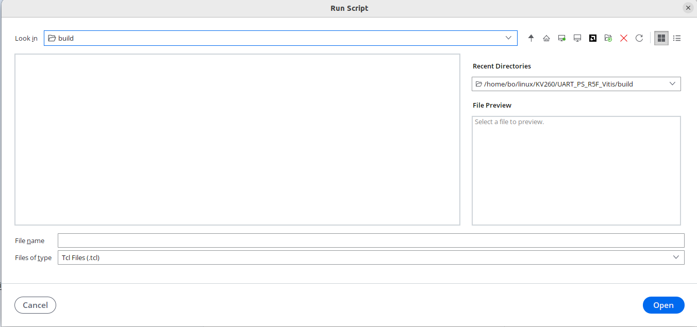
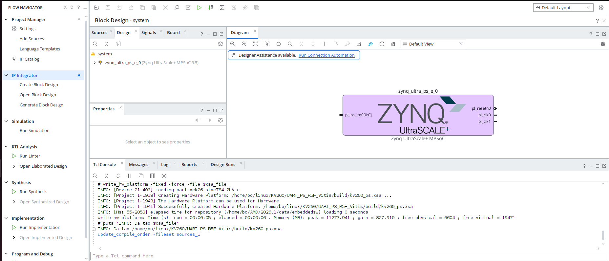
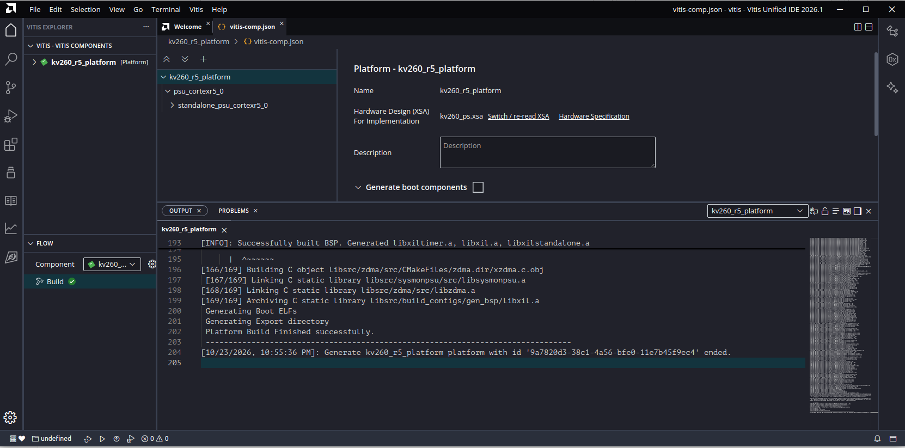
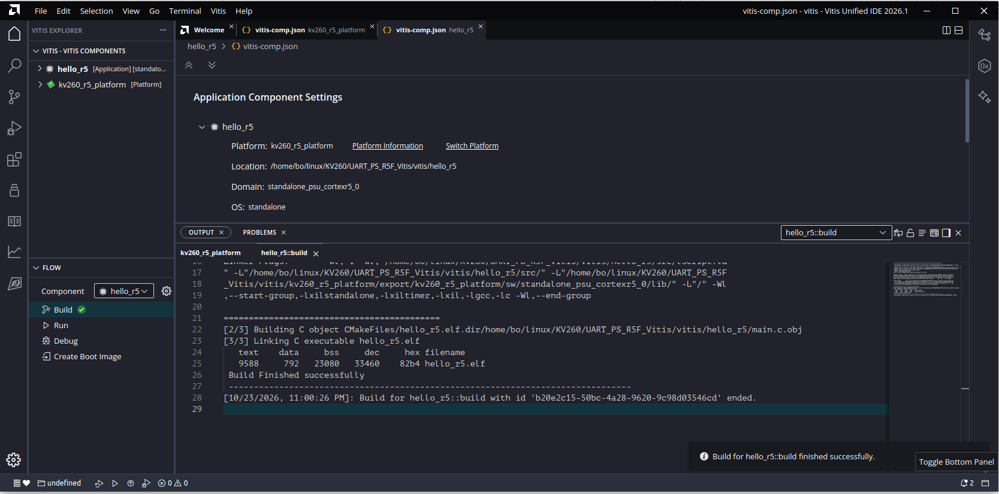

# KV260 – Hello World trên Cortex-R5F bằng Vitis (BSP standalone)

Chương trình bare-metal chạy trên lõi **Cortex-R5F #0** của Kria KV260, in chữ ra **PS UART1**, chỉ dùng phần PS (không dùng PL). Phần mềm dùng platform, BSP standalone và driver do **Vitis IDE** sinh ra.

Đã chạy thành công trên board ngày **23/10/2026**. Kết quả thật trên `/dev/ttyUSB1` (115200 8N1):

```
==============================
 Hello World from Cortex-R5F
 Board: Kria KV260 (Vitis BSP)
==============================
MPIDR = 0xC0000100 (core 0)
CPU clock  = 533328002 Hz
UART ref   = 99999001 Hz
Baud       = 115200
tick 0  (t = 0 ms)
tick 1  (t = 1000 ms)
tick 2  (t = 2000 ms)
...
```

---

## Mục lục

1. [Tổng quan](#1-tổng-quan)
2. [Cấu trúc thư mục](#2-cấu-trúc-thư-mục): [trước khi build](#21-trước-khi-build), [sau khi build](#22-sau-khi-build)
3. [Chuẩn bị: terminal, phần cứng (XSA), mở Vitis IDE](#3-chuẩn-bị-terminal-phần-cứng-xsa-mở-vitis-ide)
4. [Tạo Platform component](#4-tạo-platform-component)
5. [Tạo Application component và build](#5-tạo-application-component-và-build)
6. [Kết nối board và mở UART](#6-kết-nối-board-và-mở-uart)
7. [Nạp và chạy bằng xsdb](#7-nạp-và-chạy-bằng-xsdb)
8. [Sửa code rồi nạp lại](#8-sửa-code-rồi-nạp-lại)
9. [Đọc `main.c`: các API Vitis được dùng](#9-đọc-mainc-các-api-vitis-được-dùng)
10. [Bên trong BSP: code khởi động](#10-bên-trong-bsp-code-khởi-động)
11. [Các lỗi đã gặp và cách sửa](#11-các-lỗi-đã-gặp-và-cách-sửa)
12. [Tóm tắt lệnh](#12-tóm-tắt-lệnh)
13. [Bước tiếp theo](#13-bước-tiếp-theo)

---

## 1. Tổng quan

| Thành phần | Dùng gì |
|---|---|
| Phần cứng | Vivado: chỉ khối Zynq UltraScale+ (board preset KV260, UART1 trên MIO 36/37) → `kv260_ps.xsa` |
| Code khởi động | `boot.S`, `asm_vectors.S`, `xil-crt0.S` của BSP standalone |
| Linker script | `lscript.ld` do Vitis sinh (vector ở ATCM, còn lại ở DDR) |
| MPU / cache | BSP **bật MPU + I/D-cache** |
| Địa chỉ, tần số clock | `xparameters.h` do Vitis sinh từ XSA |
| UART | Driver `XUartPs` (`xuartps.h`) |
| printf | `xil_printf` |
| Trễ thời gian | `sleep()`, `XTime_GetTime()` (thư viện `xiltimer`, dùng TTC3) |
| Build | Vitis IDE (bên dưới là CMake + ninja) |
| Nạp | xsdb gõ tay qua JTAG, không cần thẻ SD |
| Kích thước `.text` | khoảng 9.6 KB |

**Ai làm gì:**
- `psu_init` (sinh từ Vivado): cấu hình PLL, clock, DDR, pin MIO, nhả reset ngoại vi.
- BSP (sinh từ Vitis): vector, stack, MPU, cache, driver UART và timer.
- `main.c`: gọi API của BSP để in ra UART và đếm thời gian.

---

## 2. Cấu trúc thư mục

### 2.1 Trước khi build

Đây là những file bạn tự viết hoặc giữ trong project. Chỉ có vài file:

```
UART_PS_R5F_Vitis/
├── Makefile                make hw / make ide / make console / make clean
├── README.md               Tài liệu này
├── images/                 Ảnh chụp màn hình dùng trong README
├── hw/
│   └── create_hw.tcl       Script Vivado: thiết kế PS (KV260 preset, UART1 MIO 36/37) -> XSA
└── src/
    └── main.c              Code ứng dụng, sẽ được thêm vào app lúc tạo trong IDE
```

| File | Ai viết | Dùng ở bước |
|---|---|---|
| `hw/create_hw.tcl` | Tự viết, tạo thiết kế PS và xuất XSA | `make hw` hoặc Vivado GUI (mục 3.2) |
| `src/main.c` | Tự viết, chỉ gọi API Vitis | Wizard tạo app, màn *Source Files* (mục 5.1) |
| `Makefile` | Tự viết | Gõ lệnh `make` |

Muốn quay về trạng thái này (xóa hết mọi thứ sinh ra): đóng Vitis IDE, rồi

```bash
rm -rf vitis build .Xil
```

### 2.2 Sau khi build

Các thư mục `build/` và `vitis/` được sinh ra. Cột bên phải ghi **bước nào tạo ra** file đó:

```
UART_PS_R5F_Vitis/
├── Makefile, README.md, images/, hw/, src/          (giữ nguyên như 2.1)
│
├── build/                                  ◄ make hw hoặc Vivado GUI (mục 3.2)
│   ├── kv260_ps.xsa                        Phần cứng từ Vivado
│   ├── hw/psu_init.tcl                     Script khởi tạo PS, dùng trong xsdb (mục 7.4)
│   └── vivado/                             Project Vivado (mở bằng GUI để xem block design)
│
└── vitis/                                  ◄ make ide (mục 3.3): workspace Vitis
    ├── _ide/                               Dữ liệu riêng của IDE
    │
    ├── kv260_r5_platform/                  ◄ wizard Platform (mục 4.1): PLATFORM COMPONENT
    │   ├── vitis-comp.json                 Cấu hình platform (Settings trong IDE)
    │   ├── hw/                             Bản copy của XSA
    │   ├── logs/                           Log build platform
    │   ├── psu_cortexr5_0/standalone_psu_cortexr5_0/bsp/
    │   │   └── libsrc/                     Mã nguồn BSP + driver (uartps/, ttcps/, standalone/...)
    │   └── export/kv260_r5_platform/       ◄ Build platform (mục 4.2)
    │       ├── kv260_r5_platform.xpfm      File platform mà app tham chiếu
    │       └── sw/standalone_psu_cortexr5_0/
    │           ├── include/
    │           │   ├── xparameters.h       Địa chỉ + tần số mọi ngoại vi (sinh từ XSA)
    │           │   ├── bspconfig.h         STDOUT_BASEADDRESS
    │           │   ├── xtimer_config.h     Timer dùng cho sleep()
    │           │   └── xuartps.h, ...      Header driver
    │           └── lib/                    libxil.a, libxilstandalone.a, libxiltimer.a
    │
    └── hello_r5/                           ◄ wizard Application (mục 5.1): APPLICATION COMPONENT
        ├── main.c                          ★ CODE CỦA BẠN (copy từ src/main.c), sửa ở đây
        ├── vitis-comp.json
        ├── src/
        │   ├── lscript.ld                  Linker script (Vitis sinh)
        │   ├── UserConfig.cmake            Danh sách file nguồn, cờ biên dịch
        │   └── CMakeLists.txt
        └── build/                          ◄ Build app (mục 5.3)
            ├── hello_r5.elf                ★ FILE ĐỂ NẠP (dow trong xsdb, mục 7.6)
            ├── hello_r5.map                Hàm/biến nằm ở địa chỉ nào
            └── build.log
```

**Lưu ý:** khi tạo app, IDE copy `src/main.c` vào **`vitis/hello_r5/main.c`** (nằm ngay trong `hello_r5/`, không phải trong `hello_r5/src/`). Từ đó về sau chỉ sửa file `vitis/hello_r5/main.c`. File `src/main.c` ở thư mục gốc không còn được dùng khi build.

---

## 3. Chuẩn bị: terminal, phần cứng (XSA), mở Vitis IDE

### 3.1 Nạp môi trường Xilinx

Mỗi terminal mới đều phải chạy lệnh này trước:

```bash
cd ~/linux/KV260/UART_PS_R5F_Vitis
source /home/bo/AMD/2026.1/Vitis/settings64.sh
```

Lệnh này thêm `vivado`, `vitis`, `xsdb`, `armr5-none-eabi-gcc` vào PATH.

### 3.2 Tạo phần cứng (XSA)

Có 3 cách, **kết quả giống nhau**: `build/kv260_ps.xsa` và `build/hw/psu_init.tcl`. Chọn một cách là đủ.

| Cách | Dùng gì | Khi nào nên dùng |
|---|---|---|
| A | Terminal: `make hw` | Mặc định, nhanh, lần nào cũng ra kết quả giống nhau |
| B | Vivado GUI chạy script `create_hw.tcl` | Muốn nhìn Vivado tạo từng bước trên màn hình |
| C | Vivado GUI, tự bấm tay từng bước | Muốn hiểu script làm gì (nên làm một lần để học) |

Sau cách A hoặc B, có thể [mở project bằng Vivado GUI](#xem-project-bằng-vivado-gui) để xem block design.

#### Cách A: Terminal (`make hw`)

```bash
make hw
```

Lệnh này chạy `vivado -mode batch -source hw/create_hw.tcl` (khoảng 1–2 phút, không mở cửa sổ), rồi giải nén `psu_init.tcl` ra khỏi XSA. Kết quả:
- `build/kv260_ps.xsa`
- `build/hw/psu_init.tcl`
- `build/vivado/kv260_ps.xpr` (project Vivado)

Nếu `make` báo:

```
make: Nothing to be done for 'hw'.
```

thì **không phải lỗi**. `make` chỉ build lại khi file nguồn (`hw/create_hw.tcl`) mới hơn file kết quả (`build/kv260_ps.xsa`). XSA đã có sẵn nên `make` không làm gì. Muốn ép chạy lại Vivado:

```bash
make -B hw
```

#### Cách B: Chạy script trong Vivado GUI

```bash
cd ~/linux/KV260/UART_PS_R5F_Vitis
source /home/bo/AMD/2026.1/Vitis/settings64.sh
mkdir -p build && cd build      # để file log vivado.log, vivado.jou nằm trong build/
vivado &
```

Trong Vivado, chọn một trong hai:
- Menu **Tools → Run Tcl Script…** → chọn `UART_PS_R5F_Vitis/hw/create_hw.tcl`.

  Hộp thoại **Run Script** mở sẵn thư mục `build/` (nơi chạy `vivado`), nên lúc đầu trống:

  

  Gõ đường dẫn đầy đủ vào ô **File name**: `/home/bo/linux/KV260/UART_PS_R5F_Vitis/hw/create_hw.tcl` → **Open**.
  Hoặc bấm icon **↑** (lên một cấp) cạnh ô *Look in* → double-click **hw** → chọn **create_hw.tcl** (ô *File Preview* hiện nội dung script) → **Open**.
- Hoặc gõ vào ô **Tcl Console** ở dưới cùng:
  ```tcl
  source ../hw/create_hw.tcl
  ```

Vivado sẽ lần lượt tạo project, block design, khối Zynq và xuất XSA ngay trên màn hình. Khi Tcl Console hiện `INFO: Da tao .../build/kv260_ps.xsa` là xong.

Kết quả sau khi script chạy xong:



Cách đọc màn hình:
- **Diagram:** block design `system` chỉ có một khối **zynq_ultra_ps_e_0** (Zynq UltraScale+ MPSoC). Các chân `pl_clk0`, `pl_clk1`, `pl_resetn0`, `pl_ps_irq0` là cổng sang PL do board preset bật sẵn, không nối gì vì bài này không dùng PL.
- Dòng **Designer Assistance available. Run Connection Automation**: bỏ qua, không cần bấm.
- **Tcl Console:** các dòng cuối cần thấy:
  ```
  INFO: [Project 1-1941] Successfully created Hardware Platform: /home/bo/linux/KV260/UART_PS_R5F_Vitis/build/kv260_ps.xsa
  INFO: Da tao /home/bo/linux/KV260/UART_PS_R5F_Vitis/build/kv260_ps.xsa
  ```

Script không phụ thuộc thư mục đang đứng: nó luôn ghi vào `UART_PS_R5F_Vitis/build/`. Vivado GUI không tự lấy `psu_init.tcl` ra, nên chạy thêm trong terminal:

```bash
cd ~/linux/KV260/UART_PS_R5F_Vitis
unzip -o build/kv260_ps.xsa psu_init.tcl -d build/hw
```

#### Cách C: Tự bấm tay từng bước trong Vivado GUI

Mở Vivado:

```bash
cd ~/linux/KV260/UART_PS_R5F_Vitis
source /home/bo/AMD/2026.1/Vitis/settings64.sh
mkdir -p build && cd build
vivado &
```

**Bước 1: Tạo project.** Menu **File → Project → New** → Next:

| Màn hình | Chọn |
|---|---|
| Project Name | Name: `kv260_ps`, Location: `.../UART_PS_R5F_Vitis/build/vivado`, bỏ tích *Create project subdirectory* |
| Project Type | **RTL Project**, tích *Do not specify sources at this time* |
| Default Part | Tab **Boards** → tìm **Kria KV260 Vision AI Starter Kit SOM** → bấm *Connections* → chọn carrier **KV260** → Next → Finish |

Nếu tab Boards không có KV260: bấm **Refresh** (hoặc *Download* ở cột Status) để tải board file từ Xilinx Board Store.

**Bước 2: Tạo block design.** Panel trái *Flow Navigator* → **IP INTEGRATOR → Create Block Design** → Design name: `system` → OK.

**Bước 3: Thêm khối Zynq.** Trong cửa sổ Diagram bấm **+** (Add IP) → gõ `zynq` → chọn **Zynq UltraScale+ MPSoC**.

**Bước 4: Áp cấu hình board.** Thanh màu xanh phía trên Diagram → **Run Block Automation** → tích **Apply Board Preset** → OK. Bước này cấu hình đúng DDR4, clock, MIO cho KV260.

**Bước 5: Chỉnh khối Zynq.** Double-click vào khối Zynq:
- **PS-PL Configuration → PS-PL Interfaces → Master Interface**: bỏ tích **AXI HPM0 FPD**, **AXI HPM1 FPD**, **AXI HPM0 LPD** (không dùng PL, để nguyên sẽ bị lỗi thiếu clock khi Validate).
- **I/O Configuration → Low Speed → I/O Peripherals → UART**: bỏ tích **UART 0**, tích **UART 1**, chọn **MIO 36 .. 37** (nối với chip FTDI → `/dev/ttyUSB1`).
- OK.

**Bước 6: Kiểm tra.** Bấm **Validate Design** (phím **F6**, hoặc icon dấu tích trên Diagram). Phải báo *Validation successful. There are no errors or critical warnings*.

**Bước 7: Sinh output và wrapper.** Tab **Sources** → chuột phải `system.bd`:
- **Generate Output Products** → Generate.
- **Create HDL Wrapper** → *Let Vivado manage wrapper and auto-update* → OK.

**Bước 8: Xuất XSA.** Menu **File → Export → Export Hardware**:
- Output: **Pre-synthesis** (không cần bitstream vì không dùng PL).
- XSA file name: `kv260_ps`, Export to: `.../UART_PS_R5F_Vitis/build`.
- Finish → được `build/kv260_ps.xsa`.

**Bước 9: Lấy `psu_init.tcl`** (terminal):

```bash
cd ~/linux/KV260/UART_PS_R5F_Vitis
unzip -o build/kv260_ps.xsa psu_init.tcl -d build/hw
```

Mỗi bước tay ứng với một đoạn trong `hw/create_hw.tcl`:

| Bước tay | Lệnh Tcl trong script |
|---|---|
| 1. Tạo project, chọn board | `create_project ... -part xck26-sfvc784-2LV-c`, `set_property board_part ...`, `board_connections` |
| 2. Create Block Design | `create_bd_design "system"` |
| 3. Thêm Zynq | `create_bd_cell -type ip -vlnv xilinx.com:ip:zynq_ultra_ps_e ...` |
| 4. Run Block Automation | `apply_bd_automation ... {apply_board_preset "1"}` |
| 5. Chỉnh Zynq | `set_property -dict {CONFIG.PSU__USE__M_AXI_GP0 {0} ... CONFIG.PSU__UART1__PERIPHERAL__IO {MIO 36 .. 37}}` |
| 6. Validate | `validate_bd_design` |
| 7. Output + wrapper | `generate_target all`, `make_wrapper -top` |
| 8. Export Hardware | `write_hw_platform -fixed -file build/kv260_ps.xsa` |
| 9. Lấy psu_init.tcl | `unzip` trong `Makefile` |

Tên menu ở trên viết theo các bản Vivado gần đây, bản 2026.1 có thể khác một chút.

Lưu ý: sau cách C, `make hw` sẽ báo *Nothing to be done* (vì XSA đã có). Nếu chạy `make -B hw`, script sẽ **ghi đè** project bạn vừa bấm tay (`create_project -force`).

#### Xem project bằng Vivado GUI

Sau cách A hoặc B, project nằm ở `build/vivado/kv260_ps.xpr`. Mở để xem:

```bash
cd ~/linux/KV260/UART_PS_R5F_Vitis
source /home/bo/AMD/2026.1/Vitis/settings64.sh
vivado build/vivado/kv260_ps.xpr &
```

- Flow Navigator → **Open Block Design** để xem khối Zynq.
- Double-click khối Zynq → xem cấu hình UART1, clock (`Clock Configuration`), DDR (`DDR Configuration`).
- Nếu chỉ xem thì đóng mà không lưu. Nếu sửa cấu hình, phải làm lại bước 6–9 của cách C để xuất XSA mới.

### 3.3 Mở Vitis IDE

```bash
make ide          # = vitis -w vitis
```

Kết quả trong terminal:

```
****** Vitis Development Environment
****** Vitis v2026.1 (64-bit)
...
Creating workspace directory: vitis
bo@bo:~/linux/KV260/UART_PS_R5F_Vitis$
```

Dấu nhắc lệnh trả về ngay, nhưng **IDE vẫn đang mở ở chế độ chạy nền**. Lần đầu mất khoảng 10–30 giây cửa sổ mới hiện. Kiểm tra IDE có đang chạy không:

```bash
ps aux | grep -E "vitis-ide|vitis-server" | grep -v grep
```

Log IDE nằm ở `~/.Xilinx/Vitis/2026.1/logs/ide.log`.

---

## 4. Tạo Platform component

Platform = **phần cứng (XSA) + BSP** (driver, code khởi động, thư viện) cho một lõi CPU.

### 4.1 Wizard tạo platform

Menu **File → New Component → Platform**. Wizard có 4 màn hình:

**Màn 1: Name and Location**

| Ô | Giá trị |
|---|---|
| Component name | `kv260_r5_platform` (gõ cẩn thận, đừng thừa ký tự, xem [lỗi #3](#11-các-lỗi-đã-gặp-và-cách-sửa)) |
| Component location | `/home/bo/linux/KV260/UART_PS_R5F_Vitis/vitis` (mặc định, để nguyên) |

Dòng dưới cùng cho biết thư mục sẽ được tạo: `Component will be created at .../vitis/kv260_r5_platform`. → **Next**.

**Màn 2: Flow**

- Chọn **Hardware Design**.
- **Browse** → chọn `/home/bo/linux/KV260/UART_PS_R5F_Vitis/build/kv260_ps.xsa`.
- → **Next**.

**Màn 3: OS and Processor**

| Ô | Giá trị |
|---|---|
| Operating system | **standalone** |
| Processor | **psu_cortexr5_0** |
| Generate Boot artifacts | **Bỏ tích** |

Bỏ tích *Generate Boot artifacts* vì ta nạp bằng JTAG + `psu_init.tcl`, không cần FSBL/PMUFW. → **Next**.

**Màn 4: Summary** → **Finish**.

### 4.2 Build platform

Ở panel **FLOW** (góc dưới bên trái IDE):
- Ô **Component**: chọn `kv260_r5_platform`
- Bấm **Build**

Cửa sổ OUTPUT hiện (rút gọn):

```
[10/23/2026, 10:09:08 PM]: Generate kv260_r5_platform platform ... started.
[INFO]: Building BSP
[1/169] ========== BSP Build Information ==========
Compiler PATH: .../armr5-none-eabi-gcc
Compiler FLAGS: -DSDT -mcpu=cortex-r5 -mfloat-abi=hard -mfpu=vfpv3-d16 -DARMR5 ... -O2 -g
[2/169] Building C object libsrc/standalone/src/.../outbyte.c.obj
...
[43/169] Building ASM object libsrc/standalone/src/.../cortexr5/gcc/boot.S.obj
...
[164/169] Linking C static library libsrc/xiltimer/src/libxiltimer.a
...
warning: #warning The xbasics_type.h file is deprecated ...      <- bỏ qua (xem lỗi #4)
[INFO]: Successfully built BSP. Generated libxiltimer.a, libxil.a, libxilstandalone.a
[169/169] Archiving C static library libsrc/build_configs/gen_bsp/libxil.a
Generating Boot ELFs
Generating Export directory
Platform Build Finished successfully.
```

Dòng cần thấy: **`Platform Build Finished successfully.`** BSP gồm khoảng 170 file, build mất vài giây.

Kết quả trong Vitis IDE sau khi build platform:



Cách đọc màn hình:
- **VITIS COMPONENTS** (trái trên): có component `kv260_r5_platform [Platform]`.
- **FLOW** (trái dưới): Component `kv260_r5_platform`, nút **Build** có dấu tích xanh, nghĩa là build thành công.
- **vitis-comp.json** (giữa): cấu hình platform. Cây bên trái là `kv260_r5_platform → psu_cortexr5_0 → standalone_psu_cortexr5_0` (domain). Bên phải: Hardware Design là `kv260_ps.xsa`, ô **Generate boot components** không tích (đúng như đã chọn ở màn 3).
- **OUTPUT** (dưới): log build, các dòng cuối là `Successfully built BSP`, `Platform Build Finished successfully.`

### 4.3 Kiểm tra stdout của BSP (tùy chọn)

`xil_printf` in ra UART nào là do tham số BSP `standalone_stdout` quyết định. XSA chỉ bật UART1 nên Vitis tự chọn đúng. Kiểm tra bằng terminal:

```bash
grep BASEADDRESS vitis/kv260_r5_platform/export/kv260_r5_platform/sw/standalone_psu_cortexr5_0/include/bspconfig.h
```

```
#define STDIN_BASEADDRESS 0xff010000
#define STDOUT_BASEADDRESS 0xff010000      <- 0xFF010000 = UART1, đúng
```

Muốn xem/sửa trong IDE: **kv260_r5_platform → Settings → vitis-comp.json → psu_cortexr5_0 → standalone_psu_cortexr5_0 → Board Support Package → standalone**.

---

## 5. Tạo Application component và build

### 5.1 Wizard tạo application

Menu **File → New Component → Application**. Wizard (tiêu đề *Create Application Component – Empty Application*) có 5 màn hình:

**Màn 1: Name and Location**

| Ô | Giá trị |
|---|---|
| Component name | `hello_r5` |
| Component location | `.../UART_PS_R5F_Vitis/vitis` (để nguyên) |

→ **Next**.

**Màn 2: Hardware** → chọn platform **`kv260_r5_platform`** → **Next**.

**Màn 3: Domain** → chọn **`standalone_psu_cortexr5_0`** → **Next**.

**Màn 4: Source Files** (thêm code ngay lúc tạo app)

1. Trong ô **ADD SOURCES**, bấm **icon thứ nhất** ở góc phải (hình tờ giấy có dấu +, *Add Files*). Icon thứ hai (hình thư mục) dùng để thêm cả thư mục.
2. Chọn file `/home/bo/linux/KV260/UART_PS_R5F_Vitis/src/main.c`.
3. Giữ tích **Copy sources to component**. Dòng dưới cho biết: `Sources will be copied to .../vitis/hello_r5`.
4. Dòng *Reminder* về `lscript.ld` không liên quan: `main.c` không kèm linker script, Vitis tự sinh.
5. → **Next**.

**Màn 5: Summary** → kiểm tra platform `kv260_r5_platform`, domain `standalone_psu_cortexr5_0` → **Finish**.

Góc dưới bên phải IDE hiện: *Created component: hello_r5*.

### 5.2 Hộp thoại "Application – Platform Build Dependency"

Lần đầu build app, IDE hỏi khi build app có build luôn platform không:

```
Changes in Platform BSP won't automatically trigger a rebuild.
( ) Always build platform with application
( ) Only build application (manually build platform if needed)
```

Đã chọn:
- **Always build platform with application**: nếu sau này đổi cài đặt BSP, app sẽ tự dùng BSP mới. Platform đã build rồi nên các lần sau chỉ build lại phần thay đổi, mất khoảng 1–2 giây.
- Bấm **Save in Workspace Preference**: cài đặt chỉ áp dụng cho workspace `vitis/` này.

### 5.3 Build app

Panel **FLOW** → Component: **`hello_r5`** → **Build**. Kết quả thật:

```
[10/23/2026, 10:17:07 PM]: Build for hello_r5::build ... started.
Command: bash -c unset CC CXX ;empyro build_app -s .../vitis/hello_r5/src -b .../vitis/hello_r5/build
[INFO]: Starting Application build process
[1/3] ==========Application Build Information ==========
Compiler Flags:   -DSDT -mcpu=cortex-r5 -mfloat-abi=hard -mfpu=vfpv3-d16 -DARMR5 ... -O0 -g3
Linker Flags:     -Wl,-T -Wl,".../hello_r5/src/lscript.ld" ...
                  -Wl,--start-group,-lxilstandalone,-lxiltimer,-lxil,-lgcc,-lc -Wl,--end-group
[2/3] Building C object CMakeFiles/hello_r5.elf.dir/.../vitis/hello_r5/main.c.obj
[3/3] Linking C executable hello_r5.elf
   text    data     bss     dec     hex filename
   9588     792   23080   33460    82b4 hello_r5.elf
 Build Finished successfully
```

Dòng cần thấy: **`Build Finished successfully`**. Kết quả: `vitis/hello_r5/build/hello_r5.elf`.

Kết quả trong Vitis IDE sau khi build app:



Cách đọc màn hình:
- **VITIS COMPONENTS** (trái trên): có 2 component, `hello_r5 [Application]` và `kv260_r5_platform [Platform]`.
- **FLOW** (trái dưới): Component `hello_r5`, nút **Build** có dấu tích xanh. Bên dưới có thêm **Run**, **Debug**, **Create Boot Image** (bài này không dùng, nạp bằng xsdb ở mục 7).
- **vitis-comp.json của hello_r5** (giữa): Platform `kv260_r5_platform`, Location `.../vitis/hello_r5`, Domain `standalone_psu_cortexr5_0`, OS `standalone`.
- **OUTPUT** (dưới, tab `hello_r5::build`): dòng `[3/3] Linking C executable hello_r5.elf`, bảng kích thước, rồi `Build Finished successfully`.
- Góc dưới phải hiện thông báo *Build for hello_r5::build finished successfully.*

Đọc log:
- IDE thực chất chạy lệnh `empyro build_app` (CMake + ninja).
- App build với `-O0 -g3` (cấu hình Debug), còn BSP build với `-O2`.
- Link với 3 thư viện của platform: `libxilstandalone.a` (boot, xil_printf), `libxiltimer.a` (sleep, XTime), `libxil.a` (driver).
- `text 9588` byte: gồm code của bạn cộng với driver UART, timer, code khởi động, MPU, cache.

### 5.4 Kiểm tra ELF (terminal)

```bash
armr5-none-eabi-readelf -hS vitis/hello_r5/build/hello_r5.elf | grep -E "Entry|\] \.(vectors|bootdata|text) "
```

```
  Entry point address:               0x3c
  [ 1] .vectors     PROGBITS   00000000 ... 000654   <- ATCM: bảng vector + boot.S
  [ 2] .bootdata    PROGBITS   00000658 ... 000180   <- ATCM: bảng cấu hình MPU
  [ 3] .text        PROGBITS   00100000 ... 001ad4   <- DDR
```

- **Entry = 0x3c**: là `_boot` trong `boot.S`, nằm ngay sau bảng vector.
- Code, dữ liệu, stack nằm ở **DDR (0x100000)**. Vì vậy **phải chạy `psu_init`** (khởi tạo DDR) trước khi nạp.

---

## 6. Kết nối board và mở UART

### 6.1 Kiểm tra board đã vào máy ảo

Máy Ubuntu chạy trong VMware nên USB của board phải được gắn vào VM:

```bash
lsusb | grep 0403        # phải thấy: Future Technology Devices ... 0403:6011
ls /dev/ttyUSB*          # phải có /dev/ttyUSB0 .. /dev/ttyUSB3
```

Nếu không thấy (xem [lỗi #5](#11-các-lỗi-đã-gặp-và-cách-sửa)):
1. Kiểm tra nguồn 12V và cáp micro-USB **J4**.
2. VMware: **VM → Removable Devices → Future Technology Devices → Connect (Disconnect from host)**.
3. Hoặc rút cáp USB rồi cắm lại, chọn *Connect to virtual machine*.

### 6.2 Mở cổng UART (Terminal 1)

```bash
picocom -b 115200 /dev/ttyUSB1       # hoặc: make console
```

Khi mở được sẽ hiện:

```
port is        : /dev/ttyUSB1
flowcontrol    : none
baudrate is    : 115200
...
Terminal ready
```

Để nguyên terminal này. Thoát picocom: **`Ctrl+A`** rồi **`Ctrl+X`**.

---

## 7. Nạp và chạy bằng xsdb

### 7.1 Mở xsdb (Terminal 2)

```bash
cd ~/linux/KV260/UART_PS_R5F_Vitis
source /home/bo/AMD/2026.1/Vitis/settings64.sh
xsdb
```

Gõ từng lệnh sau vào dấu nhắc `xsdb%`. Bên dưới mỗi bước là **kết quả thật** đã chạy.

### 7.2 Bước 1: Kết nối JTAG

```tcl
connect
```

```
attempting to launch hw_server
INFO: To connect to this hw_server instance use url: TCP:127.0.0.1:3121
tcfchan#0
```

xsdb tự khởi động `hw_server` để nói chuyện với chip FTDI (JTAG).

### 7.3 Bước 2: Chuyển sang boot JTAG và reset hệ thống

```tcl
targets -set -filter {name =~ "PSU"}
mwr 0xff5e0200 0x0100
rst -system
after 2000
```

| Lệnh | Ý nghĩa |
|---|---|
| `targets -set -filter {name =~ "PSU"}` | Chọn target PSU (toàn bộ PS) để ghi thanh ghi hệ thống |
| `mwr 0xff5e0200 0x0100` | `CRL_APB.BOOT_MODE_USER`: chọn boot mode JTAG. KV260 không có công tắc boot mode, chân MODE nối cứng QSPI |
| `rst -system` | Reset toàn bộ PS. Sau reset, chip boot theo mode JTAG nên không chạy Linux từ QSPI nữa |
| `after 2000` | Chờ 2 giây cho reset xong |

Thanh ghi `BOOT_MODE_USER` giữ giá trị qua `rst -system` và chỉ mất khi **rút nguồn**. Không có gì bị ghi vĩnh viễn.

### 7.4 Bước 3: Khởi tạo PS

```tcl
targets -set -filter {name =~ "APU*"}
source build/hw/psu_init.tcl
psu_init
psu_ps_pl_isolation_removal
psu_ps_pl_reset_config
```

| Lệnh | Ý nghĩa |
|---|---|
| `targets -set -filter {name =~ "APU*"}` | Chọn APU làm target để chạy các lệnh ghi thanh ghi của `psu_init` |
| `source build/hw/psu_init.tcl` | Chỉ nạp các hàm Tcl, chưa chạy gì |
| `psu_init` | Cấu hình PLL, clock, **DDR**, pin MIO (UART1 ở MIO 36/37), nhả reset ngoại vi (UART1, **TTC3**...) |
| `psu_ps_pl_isolation_removal` | Bỏ cách ly giữa PS và PL |
| `psu_ps_pl_reset_config` | Cấu hình reset PS–PL |

Các lệnh này không in gì nếu thành công.

### 7.5 Bước 4: Bật nguồn RPU và TCM

```tcl
targets -set -filter {name =~ "PSU"}
mwr 0xffd80118 0x0000F400
mwr 0xffd80120 0x0000F400
after 500
mrd 0xffd80100
```

```
FFD80100:   00DFFC8F
```

| Lệnh | Ý nghĩa |
|---|---|
| `mwr 0xffd80118 0x0000F400` | `PMU_GLOBAL.REQ_PWRUP_INT_EN`: cho phép yêu cầu bật nguồn bit 10 (RPU) và bit 12–15 (TCM 0A/0B/1A/1B) |
| `mwr 0xffd80120 0x0000F400` | `PMU_GLOBAL.REQ_PWRUP_TRIG`: kích hoạt yêu cầu, PMU ROM sẽ bật nguồn |
| `mrd 0xffd80100` | `PMU_GLOBAL.PWR_STATE`: đọc trạng thái nguồn. **`0x00DFFC8F`** nghĩa là bit 10–15 = 1, đúng |

Bình thường PMU firmware làm việc này. Boot JTAG không có PMU firmware nên ta gửi yêu cầu trực tiếp cho PMU ROM. Nếu bỏ bước này, `rst -processor` sẽ báo lỗi (xem [lỗi #8](#11-các-lỗi-đã-gặp-và-cách-sửa)).

### 7.6 Bước 5: Nạp ELF vào R5 #0 và chạy

```tcl
targets -set -filter {name =~ "*R5*#0"}
rst -processor
dow vitis/hello_r5/build/hello_r5.elf
con
```

Kết quả thật:

```
xsdb% rst -processor
WARNING: If the reset is being triggered after powering on the device,
         write bootloop at reset vector address (0xffff0000), or use
         -clear-registers option, to avoid unpredictable behavior.
         Further warnings will be suppressed
Info: Cortex-R5 #0 (target 7) Stopped at 0xffff0000 (Suspended)

xsdb% dow vitis/hello_r5/build/hello_r5.elf
Downloading Program -- .../vitis/hello_r5/build/hello_r5.elf
        section, .vectors: 0x00000000 - 0x00000653
        section, .bootdata: 0x00000658 - 0x000007d7
        section, .text: 0x00100000 - 0x00101ad3
        section, .note.gnu.build-id: 0x00101ad4 - 0x00101af7
        section, .init: 0x00101af8 - 0x00101b03
        section, .fini: 0x00101b04 - 0x00101b0f
        section, .rodata: 0x00101b10 - 0x00101f1f
        section, .data: 0x00101f20 - 0x00101f5f
        section, .ARM.exidx: 0x00101f60 - 0x00101f67
        section, .init_array: 0x00101f68 - 0x00101f6f
        section, .fini_array: 0x00101f70 - 0x00101f73
        section, .drvcfg_sec: 0x00101f74 - 0x001020bf
        section, .bss: 0x001020c0 - 0x001022e7
        section, .heap: 0x001022e8 - 0x001042ef
        section, .stack: 0x001042f0 - 0x00107aef
100%    0MB   0.0MB/s  00:00
Setting PC to Program Start Address 0x0000003c
Successfully downloaded .../vitis/hello_r5/build/hello_r5.elf

xsdb% con
Info: Cortex-R5 #0 (target 7) Running
```

| Lệnh | Ý nghĩa |
|---|---|
| `targets -set -filter {name =~ "*R5*#0"}` | Chọn lõi Cortex-R5 #0 |
| `rst -processor` | Reset riêng lõi R5 #0, dừng ở `0xFFFF0000`. Dòng WARNING là bình thường |
| `dow ...elf` | Ghi từng section vào bộ nhớ: `.vectors`, `.bootdata` vào ATCM (0x0), còn lại vào DDR (0x100000), rồi đặt PC = 0x3c |
| `con` | Cho R5 chạy |

Ngay sau `con`, terminal picocom hiện `Hello World from Cortex-R5F` và `tick` tăng mỗi giây.

### 7.7 Thoát xsdb

```tcl
disconnect
exit
```

R5 vẫn tiếp tục chạy sau khi thoát xsdb.

---

## 8. Sửa code rồi nạp lại

Khi board **chưa rút nguồn**:

1. Trong Vitis IDE, sửa **`vitis/hello_r5/main.c`**, lưu (`Ctrl+S`).
2. Panel **FLOW** → Component `hello_r5` → **Build**. Chờ `Build Finished successfully`.
3. Trong xsdb (nếu đã thoát thì `connect` lại trước):

```tcl
targets -set -filter {name =~ "*R5*#0"}
rst -processor
dow vitis/hello_r5/build/hello_r5.elf
con
```

Không cần làm lại bước 2–4 (boot mode, `psu_init`, bật nguồn RPU).

Nếu **đã rút nguồn** board: làm lại toàn bộ mục 7 từ `connect`.

---

## 9. Đọc `main.c`: các API Vitis được dùng

### 9.1 Khởi tạo UART

```c
cfg = XUartPs_LookupConfig(XPAR_XUARTPS_0_BASEADDR);
XUartPs_CfgInitialize(&uart, cfg, cfg->BaseAddress);
XUartPs_SetBaudRate(&uart, 115200);
```

| API | Bên trong nó làm (mã nguồn ở `bsp/libsrc/uartps/src/`) |
|---|---|
| `XUartPs_LookupConfig` | Tìm trong bảng `XUartPs_ConfigTable` (file `xuartps_g.c`, sinh từ XSA) phần tử có địa chỉ base khớp. Trả về base address + `InputClockHz` |
| `XUartPs_CfgInitialize` | Ghi `MR` = 8N1, tắt ngắt (`IDR`), reset và bật TX/RX (`CR`), đặt baud mặc định |
| `XUartPs_SetBaudRate` | Thử các BDIV từ 4 đến 254, chọn CD và BDIV sai số nhỏ nhất, ghi `BAUDGEN`, `BAUDDIV` |
| `XUartPs_Send` | Ghi vào `FIFO` khi `SR.TXFULL = 0`, trả về số byte đã gửi |

**Tên `XPAR_XUARTPS_0`:** XSA chỉ bật UART1, nên trong `xparameters.h` nó là instance **số 0** dù phần cứng là UART1:

```c
#define XPAR_XUARTPS_0_BASEADDR   0xff010000     /* = UART1 */
#define XPAR_XUARTPS_0_CLOCK_FREQ 0x5f5dd19      /* 99999001 Hz */
```

Từ Vitis 2023.2 (flow **SDT**, System Device Tree), `LookupConfig` nhận **địa chỉ base**, không nhận `DeviceId` như các ví dụ cũ trên mạng (`XPAR_XUARTPS_0_DEVICE_ID`). Dùng ví dụ cũ sẽ bị lỗi biên dịch.

### 9.2 `xil_printf`

Nhẹ hơn `printf` của newlib, không hỗ trợ số thực, in hex chữ hoa (`0xC0000100`). Đường đi của mỗi ký tự:

```
xil_printf() -> outbyte(c) -> XUartPs_SendByte(STDOUT_BASEADDRESS, c) -> FIFO của UART1
```

`STDOUT_BASEADDRESS` nằm trong `bspconfig.h`, do tham số BSP `standalone_stdout` quyết định. `xil_printf` không tự khởi tạo UART, nó chỉ ghi vào FIFO. Baud do `XUartPs_SetBaudRate` (hoặc `psu_init`) đặt.

### 9.3 Thời gian: `sleep()` và `XTime_GetTime()`

Thư viện `xiltimer` chọn một timer làm "sleep timer". Xem `include/xtimer_config.h`:

```c
#define XSLEEPTIMER_BASEADDRESS 0xff140000   /* TTC3 */
#define XSLEEPTIMER_IS_TTCPS
#define XSLEEPTIMER_FREQ        0x5f5e100    /* 100 MHz */
#define COUNTS_PER_SECOND       XSLEEPTIMER_FREQ
```

- `sleep(1)`: chờ bận dựa trên bộ đếm TTC3.
- `XTime_GetTime(&t)`: kiểu `XTime` là `u64`, nhưng bộ đếm TTC chỉ có **32 bit** nên tràn sau khoảng 43 giây ở 100 MHz. Vì vậy `main.c` cộng dồn từng khoảng bằng phép trừ `u32` (vẫn đúng khi tràn).
- Lần gọi đầu tiên của `XTime_GetTime()` hoặc `sleep()` sẽ khởi tạo và chạy TTC3 (xem `xiltimer/src/core/ttcps/ttcps.c`).

TTC là một ngoại vi riêng (100 MHz) nên thời gian không phụ thuộc tần số CPU. Kết quả `t = 1000 ms, 2000 ms...` trên UART cho thấy timer chạy đúng.

### 9.4 Đọc MPIDR

```c
u32 mpidr = mfcp(XREG_CP15_MULTI_PROC_AFFINITY);
```

`mfcp` (trong `xpseudo_asm.h`) là macro sinh lệnh `mrc p15, 0, rX, c0, c0, 5`. Đây là cách đọc thanh ghi hệ thống của CPU mà không phải tự viết inline asm. `0xC0000100`: Aff0 = 0 là **lõi 0**, Aff1 = 1 là cụm RPU.

---

## 10. Bên trong BSP: code khởi động

Thư mục: `vitis/kv260_r5_platform/psu_cortexr5_0/standalone_psu_cortexr5_0/bsp/libsrc/standalone/src/arm/cortexr5/gcc/`

| File | Nội dung |
|---|---|
| `asm_vectors.S` | Bảng vector ở 0x0, handler IRQ/FIQ/abort viết sẵn (gọi `Xil_ExceptionHandler`) |
| `boot.S` | `_boot` (0x3c): đặt stack từng mode, tắt rồi invalidate cache, **cấu hình MPU** (bảng vùng trong `.bootdata`), bật cache, bật VFP, bật ECC check, nhảy vào `_start` |
| `xil-crt0.S` | Xóa `.bss`, gọi các hàm constructor (ví dụ `xtimerinit` của xiltimer), gọi `main` |

Muốn xem từng lệnh khởi động chạy thế nào: sau `dow`, đừng gõ `con` mà dùng:

```tcl
bpadd -addr &main      ;# breakpoint ở main
con                    ;# chạy hết boot.S, dừng ở main
rrd                    ;# xem thanh ghi
stp                    ;# chạy từng lệnh
```

---

## 11. Các lỗi đã gặp và cách sửa

| # | Hiện tượng | Nguyên nhân | Cách sửa |
|---|---|---|---|
| 1 | `make: Nothing to be done for 'hw'.` | XSA đã có, mới hơn `create_hw.tcl` | Không phải lỗi. Muốn chạy lại: `make -B hw` |
| 2 | `make ide` trả về dấu nhắc ngay, chưa thấy cửa sổ | IDE chạy nền, lần đầu khởi động chậm | Chờ 10–30 giây. Kiểm tra bằng `ps aux \| grep vitis-ide` |
| 3 | Platform bị đặt sai tên (lần đầu gõ thừa thành `kv260_r5_platformS`) | Gõ nhầm ở màn *Name and Location* | Chuột phải platform → Delete (tích xóa file trên đĩa), tạo lại. Hoặc giữ nguyên và chọn đúng tên đó khi tạo app |
| 4 | Build platform có `warning: #warning The xbasics_type.h file is deprecated` | Driver `sysmonpsu` có sẵn trong BSP dùng header cũ | Bỏ qua, không phải code của mình |
| 5 | `picocom`: `FATAL: cannot open /dev/ttyUSB1: No such file or directory` | USB của board chưa gắn vào VM (`lsusb` không thấy `0403:6011`) | VMware: VM → Removable Devices → Future Technology Devices → Connect. Kiểm tra nguồn và cáp J4 |
| 6 | `mwr 0xffe00000 ...`: `Memory write error ... Blocked address 0xFFE00000. RPU core #0 reset is active` | Ghi vào TCM khi R5 còn đang reset | Không cần ghi TCM bằng tay. `rst -processor` rồi `dow` là đủ |
| 7 | `fatal error: xtime_l.h: No such file` | Từ flow SDT, `XTime` chuyển sang thư viện `xiltimer` | `#include "xiltimer.h"` |
| 8 | `rst -processor`: `APB AP transaction error`, R5 "No Power" | Chưa bật nguồn RPU/TCM | Làm bước 4 (`0xF400` vào `0xFFD80118` và `0xFFD80120`) |
| 9 | `XPAR_XUARTPS_1_BASEADDR undeclared` | Chỉ có 1 UART trong XSA nên nó là instance 0 | Dùng `XPAR_XUARTPS_0_BASEADDR` |
| 10 | `dow` lỗi khi ghi ở 0x100000 | DDR chưa khởi tạo | Chạy `psu_init` trước |
| 11 | Sửa code nhưng board vẫn chạy chương trình trước đó | Quên Build, hoặc sửa nhầm `src/main.c` ở thư mục gốc | Sửa `vitis/hello_r5/main.c` → Build → `rst -processor`, `dow`, `con` |

---

## 12. Tóm tắt lệnh

**Lần đầu (sau khi cắm nguồn board):**

```bash
# Terminal 1 – build
cd ~/linux/KV260/UART_PS_R5F_Vitis
source /home/bo/AMD/2026.1/Vitis/settings64.sh
make hw                       # XSA (hoặc dùng Vivado GUI: mục 3.2 cách B/C)
make ide                      # tạo platform + app, Build trong IDE (mục 4, 5)

# Terminal 2 – UART
picocom -b 115200 /dev/ttyUSB1

# Terminal 3 – nạp
cd ~/linux/KV260/UART_PS_R5F_Vitis
source /home/bo/AMD/2026.1/Vitis/settings64.sh
xsdb
```

```tcl
connect
targets -set -filter {name =~ "PSU"}
mwr 0xff5e0200 0x0100
rst -system
after 2000

targets -set -filter {name =~ "APU*"}
source build/hw/psu_init.tcl
psu_init
psu_ps_pl_isolation_removal
psu_ps_pl_reset_config

targets -set -filter {name =~ "PSU"}
mwr 0xffd80118 0x0000F400
mwr 0xffd80120 0x0000F400
after 500
mrd 0xffd80100                ;# phải ra 00DFFC8F

targets -set -filter {name =~ "*R5*#0"}
rst -processor
dow vitis/hello_r5/build/hello_r5.elf
con
```

**Các lần sau (sửa code, board chưa rút nguồn):** IDE → Build, rồi:

```tcl
targets -set -filter {name =~ "*R5*#0"}
rst -processor
dow vitis/hello_r5/build/hello_r5.elf
con
```

---

## 13. Bước tiếp theo

1. **Xem kích thước:** mở `vitis/hello_r5/build/hello_r5.map`, xem driver nào chiếm chỗ trong 9.6 KB `.text`.
2. **UART nhận bằng ngắt:** dùng `XScuGic` + `XUartPs_SetHandler` + `XUartPs_SetInterruptMask`.
3. **Đặt code vào TCM:** sửa `vitis/hello_r5/src/lscript.ld` (đổi `.text`, `.data`, `.stack` sang `psu_r5_0_atcm_MEM_0` / `psu_r5_0_btcm_MEM_0`), so tốc độ với DDR.
4. **Debug bằng IDE:** panel FLOW → **Debug**, đặt breakpoint ngay trong editor thay vì gõ `bpadd` trong xsdb.
5. **Boot từ thẻ SD/QSPI:** tạo platform có tích *Generate Boot artifacts* để Vitis sinh FSBL + PMUFW, rồi dùng **Create Boot Image** trong panel FLOW để tạo `BOOT.BIN`.
